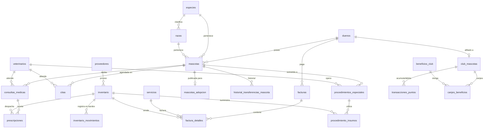

# VeterinarySystem - Sistema de Gestión Integral Veterinaria "Happy Feet"

[](https://www.oracle.com/java/)
[](https://www.mysql.com/)
[](https://maven.apache.org/)
[](#autor)

---

## Índice de Contenidos

1. [Descripción del Contexto](#descripción-del-contexto)
2. [Tecnologías Utilizadas](#tecnologías-utilizadas)
3. [Arquitectura y Patrones de Diseño](#arquitectura-y-patrones-de-diseño)
4. [Funcionalidades Implementadas](#funcionalidades-implementadas)
5. [Modelo de la Base de Datos](#modelo-de-la-base-de-datos)
6. [Instrucciones de Instalación y Configuración](#instrucciones-de-instalación-y-configuración)
   - [Requisitos Previos](#requisitos-previos)
   - [Clonación del Repositorio](#clonación-del-repositorio)
   - [Configuración de Base de Datos](#configuración-de-la-base-de-datos)
   - [Ejecución Manual de Scripts SQL](#ejecución-manual-de-scripts-sql)
7. [Métodos de Ejecución del Proyecto](#métodos-de-ejecución-del-proyecto)
   - [Opción 1: Ejecución con Maven CLI](#opción-1-ejecución-con-maven-cli)
   - [Opción 2: Ejecución desde Apache NetBeans IDE](#opción-2-ejecución-desde-apache-netbeans-ide)
   - [Opción 3: Generación y Ejecución de Archivo .JAR](#opción-3-generación-y-ejecución-de-archivo-jar-con-dependencias)
8. [Guía de Uso y Comandos Especiales](#guía-de-uso-y-comandos-especiales)
9. [Autor](#autor)

---

## Descripción del Contexto

La clínica veterinaria **"Happy Feet"** experimentaba dificultades operativas comunes en centros de atención animal en crecimiento:
- Dispersión de expedientes clínicos y pérdida de antecedentes médicos relevantes.
- Solapamiento involuntario de citas médicas en la agenda de los profesionales.
- Desfase entre los insumos médicos o fármacos administrados en quirófano/consulta y las existencias reales en farmacia.
- Dificultades para controlar productos vencidos o lotes próximos a caducar.
- Demoras en la emisión de liquidaciones fiscales y cobro de servicios tras procedimientos médicos.
- Falta de fidelización formal de propietarios y seguimiento de adopciones responsables o jornadas de vacunación comunitaria.

**VeterinarySystem** es una solución de escritorio en consola estructurada bajo una arquitectura por capas desacoplada y robusta que centraliza de manera transaccional e integral toda la operación médica, administrativa, logística y comercial de la veterinaria.

---

## Tecnologías Utilizadas

- **Lenguaje de Programación:** Java SE 17 (LTS) - Programación orientada a objetos moderna, Records, Pattern Matching y Java Stream API.
- **Motor de Base de Datos:** MySQL Server 8.0+ / MariaDB 10.5+ con motor transaccional `InnoDB`.
- **Conectividad a Datos:** JDBC nativo (`mysql-connector-j` 8.3.0) con transacciones ACID explícitas, Savepoints y PreparedStatements para prevención de inyecciones SQL.
- **Gestión y Construcción de Proyecto:** Apache Maven 3.8+.
- **Generación de Documentos Formales:** OpenPDF (LibrePDF 1.3.39) para exportación nativa de comprobantes de facturación, contratos de adopción y reportes gerenciales en formato PDF.
- **Auditoría y Bitácora:** Sistema propio de Logging en archivo físico persistente (`app_veterinaria.log`) y tabla relacional de auditoría.
- **Diseño de Interfaz:** Consola interactiva ANSI con soporte de `NO_COLOR`, maquetación de cuadros dinámicos adaptativos, paginación de tablas y comandos de control de flujo.

---

## Arquitectura y Patrones de Diseño

El sistema está estructurado bajo un enfoque arquitectónico moderno de **Empaquetado por Característica / Dominio (*Package by Feature*)**, complementado con el patrón **Modelo-Vista-Controlador (MVC)** dentro de cada módulo funcional y una capa transversal de infraestructura (`core`):

```text
randolh.veterinarysystem/
├── mascota/       --> [Modelo, DAO, Controlador, Vista] de Pacientes
├── dueno/         --> [Modelo, DAO, Controlador, Vista] de Clientes/Tutores
├── cita/          --> [Modelo, DAO, Controlador, Vista, Estados] de Citas
├── consulta/      --> [Modelo, DAO, Controlador, Vista] de Consultas y Cirugías
├── inventario/    --> [Modelo, DAO, Controlador, Vista] de Farmacia y Proveedores
├── facturacion/   --> [Modelo, DAO, Controlador, Vista] de Cobros y Ventas
├── alerta/        --> [Modelo, DAO, Controlador, Vista] de Notificaciones
├── actividad/     --> [Modelo, DAO, Controlador, Vista] de Adopciones y Jornadas
├── veterinario/   --> [Modelo, DAO, Controlador, Vista] de Profesionales
├── reporte/       --> [DAO, Controlador, Vista] de Inteligencia de Negocio
├── MenuPrincipal  --> Orquestador central con inicialización perezosa (Lazy Loading)
└── core/          --> Capa transversal compartida
    ├── config/    --> Gestión de conexión JDBC (Singleton) y asistente
    ├── exception/ --> Jerarquía de excepciones de dominio y control de flujo
    ├── patterns/  --> Implementaciones de Strategy, Factory y Observer
    └── utils/     --> Utilidades de consola ANSI, Logger y exportador PDF
```

### Principios de la Arquitectura:
1. **Alta Cohesión y Bajo Acoplamiento (*Package by Feature*):** Todo el código relacionado con un concepto de negocio (entidad, persistencia, reglas de validación e interfaz de usuario) coexiste dentro del mismo paquete de dominio, facilitando el mantenimiento y la escalabilidad.
2. **Separación de Responsabilidades (MVC):**
   - **Vista (`*View`):** Responsable exclusiva de la interacción en consola, captura mediante `ConsolaUtils`, comandos interactivos (`clear`, `:c`) y despliegue de menús y tablas.
   - **Controlador (`*Controller`):** Orquestación de reglas de negocio, validaciones defensivas de rangos y unicidad, y captura de excepciones.
   - **Modelo (`*` / `*DAO`):** Entidades de dominio ricas y Data Access Objects que encapsulan la persistencia mediante consultas preparadas en JDBC puro.
3. **Persistencia Híbrida y Transaccionalidad Delegada:** La lógica de deducción atómica de inventario y auditoría se apoya en disparadores (*triggers*) y procedimientos almacenados en MySQL, garantizando transaccionalidad ACID sin sobrecargar el código de la aplicación.
4. **Resiliencia y Modo Offline:** El sistema inicializa sus dependencias de forma perezosa (*lazy loading*) y valida la conectividad a la base de datos sin abortar la ejecución si el servidor MySQL se encuentra temporalmente inaccesible.

### Patrones de Diseño de Software Implementados:
- **Singleton:** Aplicado en [`ConexionBD`](src/main/java/randolh/veterinarysystem/core/config/ConexionBD.java) (gestión centralizada de conexión JDBC) y [`GestorEventos`](src/main/java/randolh/veterinarysystem/core/patterns/observer/GestorEventos.java).
- **Data Access Object (DAO):** Desacopla la lógica de negocio de la infraestructura MySQL en todos los módulos (`MascotaDAO`, `ConsultaDAO`, `FacturacionDAO`, `InventarioDAO`, etc.).
- **Builder:** Empleado en [`Mascota.Builder`](src/main/java/randolh/veterinarysystem/mascota/Mascota.java) y [`Factura.Builder`](src/main/java/randolh/veterinarysystem/facturacion/Factura.java) para garantizar construcciones consistentes con validaciones defensivas.
- **Observer:** Canal reactivo en [`GestorEventos`](src/main/java/randolh/veterinarysystem/core/patterns/observer/GestorEventos.java) para notificaciones instantáneas de inventario crítico (stock mínimo o vencimiento) hacia el centro de alertas.
- **Strategy:** En el sistema de fidelización del Club de Mascotas (`EstrategiaDescuento`, con implementaciones `DescuentoSinClub`, `DescuentoBronce`, `DescuentoPlata`, `DescuentoOro` y `DescuentoPlatino`).
- **Factory Method:** En [`FactoriaEstrategias`](src/main/java/randolh/veterinarysystem/core/patterns/strategy/FactoriaEstrategias.java) para instanciar dinámicamente la política de descuento según el puntaje y membresía del cliente.
- **State:** Implementado en la gestión del ciclo de vida de citas médicas (`ProgramadaState`, `ConfirmadaState`, `EnCursoState`, `FinalizadaState`, `CanceladaState`, etc.).

---

## Funcionalidades Implementadas

### Módulo 1: Gestión de Mascotas y Dueños
- **Ficha Médica Integral:** Registro completo con nombre, especie, raza, sexo, peso actual (con validación de rangos biológicos), alergias y condiciones preexistentes.
- **Cálculo de Edad Estimada:** Permite ingresar la fecha exacta de nacimiento o calcularla automáticamente introduciendo la edad estimada en años y meses.
- **Identificación:** Manejo de microchip (con índice UNIQUE), código de tatuaje y URL de fotografía.
- **Gestión de Propietarios / Dueños:** Registro con validación regex estricta de correo electrónico único, documento nacional, teléfono y contacto de emergencia.
- **Transferencia de Propiedad:** Traspaso atómico de mascota a un nuevo tutor legal con registro histórico de auditoría (`historial_transferencias_mascota`).
- **Carnet de Salud Oficial:** Exportación a archivo de texto (`carnet_mascota_<id>.txt`) integrando datos clínicos, historial de vacunas aplicadas y procedimientos quirúrgicos realizados.

### Módulo 2: Personal Veterinario
- Catálogo de profesionales médicos con número de tarjeta profesional/licencia única, especialidad médica (Cirugía, Medicina Interna, Dermatología, etc.), horario de atención y estado activo/inactivo.

### Módulo 3: Servicios Médicos y Citas
- **Agenda Médica:** Programación de citas por fecha, hora y veterinario.
- **Prevención de Solapamiento:** Regla de negocio que valida una ventana de protección médica (+/- 30 minutos) impidiendo colisiones de horarios por profesional.
- **Flujo de Estados:** Transición formal validada por estados (Programada -> Confirmada -> En Curso -> Finalizada / Cancelada / No Asistió).

### Módulo 4: Consultas Médicas, Quirófano y Deducción Atómica
- **Consultas Generales:** Captura de constantes fisiológicas (peso, temperatura), anamnesis, sintomatología, diagnóstico médico y prescripción de fármacos.
- **Cirugías y Procedimientos Especiales:** Protocolo quirúrgico completo (ayuno, medicación anestésica, técnica aplicada, complicaciones, postoperatorio y control programado).
- **Deducción Atómica de Inventario:** Al registrar una consulta con medicamentos o un procedimiento con insumos médicos, los disparadores (*triggers*) en base de datos descuentan las existencias de bodega y generan los asientos respectivos en el Kardex (`inventario_movimientos`).
- **Flujo de Facturación Inmediata:** Al finalizar una consulta o cirugía, el sistema ofrece emitir la factura fiscal de inmediato, cargando automáticamente los honorarios médicos y los ítems administrados.

### Módulo 5: Inventario, Farmacia y Proveedores
- **Catálogo de Farmacia y Bodega:** Insumos clasificados por lote, fecha de vencimiento, stock actual, stock mínimo de seguridad, costo y precio de venta.
- **Protección de Salubridad Estricta:** Bloqueo terminante de dispensación o uso médico de lotes vencidos (`fecha_vencimiento <= CURDATE()`).
- **Auditoría de Stock:** Movimientos de entrada, salida, ajustes por merma y auditoría física con cálculo de discrepancias.
- **Proveedores Comerciales:** Gestión de distribuidores de laboratorio y suministros veterinarios.

### Módulo 6: Alertas del Sistema y Notificaciones
- Monitoreo en tiempo real de productos agotados, lotes por debajo del stock mínimo y medicamentos próximos a vencer (30 días).
- **Indicador Dinámico en Menú:** El menú principal alerta en su cabecera y en la opción del módulo si existen notificaciones no atendidas (`[!] TIENE X NOTIFICACION(ES) PENDIENTE(S)`).
- Registro persistente de eventos generados por triggers de MySQL y por el evento programado diario `evt_verificar_vencimientos_diarios`.

### Módulo 7: Facturación y Finanzas
- **Liquidación Fiscal Completa:** Subtotal, cálculo parametrizable de IVA (19%) y total final.
- **Integración con Club de Fidelización:** Cálculo automático de descuentos por estrategia según la categoría del dueño (Bronce, Plata, Oro, Platino).
- **Acumulación de Puntos:** 1 punto por cada unidad monetaria consumida para canje posterior de beneficios.
- **Múltiples Métodos de Pago:** Efectivo, Tarjeta Débito/Crédito, Transferencia Bancaria y Puntos del Club.
- **Generación Dual de Comprobantes:** Emisión simultánea de factura en texto estructurado (`factura_FAC-XXXX.txt`) y documento formal en PDF (`factura_FAC-XXXX.pdf`).

### Módulo 8: Actividades Especiales y Comunitarias
- **Días de Adopción:** Publicación de pacientes rescatados, registro de adoptantes y generación automática del Contrato Legal de Adopción Responsable (TXT y PDF).
- **Jornadas de Vacunación:** Interfaz de alto rendimiento (*Fast Track*) para captura masiva de dosis en eventos comunitarios con animales con dueño o comunitarios/callejeros.
- **Club de Mascotas Frecuentes:** Afiliación, balance de puntos acumulados/disponibles y canje de beneficios autorizados.

### Módulo 9: Reportes Gerenciales e Inteligencia de Negocio
- **Servicios más Solicitados:** Ranking estadístico procesado mediante Java Stream API.
- **Desempeño Veterinario:** Atenciones realizadas, procedimientos liderados e ingresos brutos generados por médico.
- **Alertas Críticas de Inventario:** Informe de abastecimiento preventivo y análisis de lotes caducos.
- **Consolidado de Facturación Mensual:** Recaudación acumulada, desglose tributario y ticket promedio. Exportable a PDF.

### Módulo 10: Asistente y Diagnóstico de Base de Datos
- Herramienta integrada en el menú que permite diagnosticar conectividad, probar credenciales, reinicializar el esquema SQL desde Java y alternar entre modo en línea y fuera de línea sin reiniciar la aplicación.

---

## Modelo de la Base de Datos

La base de datos `happy_feet_veterinaria` cuenta con **31 tablas relacionales**, integridad referencial estricta (`ON DELETE RESTRICT` / `CASCADE`), claves foráneas compuestas, checks de validación y automatización mediante *Triggers*, *Stored Procedures*, *Functions* y *Scheduled Events*.



### Estructura de Scripts SQL:
1. `scripts_sql/01_ddl_schema.sql`: Creación de la base de datos, tablas, índices únicos y llaves foráneas.
2. `scripts_sql/02_programacion_bd.sql`: Creación de disparadores (*triggers* de deducción y stock mínimo), procedimientos almacenados de transferencia y eventos programados.
3. `scripts_sql/03_dml_seeds.sql`: Inserción de catálogos base (especies, razas, estados, tipos de insumos, servicios médicos), stock inicial de farmacia y profesionales veterinarios.
4. `scripts_sql/init_all.sql`: Script maestro para ejecución encadenada en un solo comando.

---

## Instrucciones de Instalación y Configuración

### Requisitos Previos

Antes de comenzar, asegúrese de tener instalados los siguientes componentes:
- **Java Development Kit (JDK):** Versión 17 o superior. Verifique con:
  ```bash
  java -version
  javac -version
  ```
- **Apache Maven:** Versión 3.8 o superior. Verifique con:
  ```bash
  mvn -version
  ```
- **MySQL Server:** Versión 8.0 o superior (o MariaDB 10.5+), con servicio activo en el puerto 3306.

---

### Clonación del Repositorio

Abra una terminal y clone el repositorio oficial del proyecto:

```bash
git clone https://github.com/Randolh/VeterinarySystem.git
cd VeterinarySystem
```

---

### Configuración de la Base de Datos

El sistema utiliza el archivo de propiedades `database.properties` en la raíz del proyecto para leer las credenciales de conexión.

1. Copie la plantilla de configuración de ejemplo:
   ```bash
   cp database.properties.example database.properties
   ```
2. Edite `database.properties` con los datos de su servidor local de MySQL:
   ```properties
   # Parametros del Servidor MySQL
   db.host=localhost
   db.port=3306
   db.name=happy_feet_veterinaria
   db.user=root
   db.password=TU_CONTRASENA_AQUI

   # Parametros Adicionales JDBC
   db.useSSL=false
   db.allowPublicKeyRetrieval=true
   db.serverTimezone=UTC

   # Informacion Institucional de la Clinica
   clinica.nombre=Clinica Veterinaria Happy Feet
   clinica.nit=900.123.456-7
   clinica.telefono=(+57) 300 123 4567
   clinica.direccion=Calle 123 #45-67, Bogota
   clinica.iva.porcentaje=19.0
   ```

---

### Ejecución Manual de Scripts SQL

Para inicializar la base de datos de manera manual desde la consola de comandos, ejecute los scripts respetando estrictamente el orden de dependencias:

#### Opción Rápida (Script Maestro `init_all.sql`):
```bash
mysql -u root -p < scripts_sql/init_all.sql
```

#### Opción Paso a Paso:
```bash
# 1. Crear el esquema de tablas y restricciones
mysql -u root -p < scripts_sql/01_ddl_schema.sql

# 2. Configurar triggers, stored procedures, vistas y eventos
mysql -u root -p < scripts_sql/02_programacion_bd.sql

# 3. Insertar datos semilla (catálogos, servicios y registros de prueba)
mysql -u root -p < scripts_sql/03_dml_seeds.sql
```

> [!NOTE]
> También puede inicializar la base de datos de forma asistida desde la aplicación ingresando a la **Opción 10 (Asistente y Diagnóstico de Base de Datos)**.

---

## Métodos de Ejecución del Proyecto

### Opción 1: Ejecución con Maven CLI

Es la opción más directa y recomendada para desarrollo y pruebas en consola.

1. Compile el proyecto:
   ```bash
   mvn clean compile
   ```
2. Ejecute la aplicación mediante el plugin de ejecución configurado:
   ```bash
   mvn exec:java
   ```

*(O en un solo paso):*
```bash
mvn clean compile exec:java
```

---

### Opción 2: Ejecución desde Apache NetBeans IDE

1. Abra **Apache NetBeans**.
2. Vaya al menú superior: **File -> Open Project...**
3. Navegue hasta la carpeta del proyecto `VeterinarySystem` (NetBeans la reconocerá automáticamente por el icono de proyecto Maven con el archivo `pom.xml`).
4. Haga clic derecho sobre el proyecto en la barra lateral y seleccione **Clean and Build** (o presione `Shift + F11`).
5. Haga clic derecho sobre el proyecto y seleccione **Run** (o presione `F6`).
6. Si NetBeans le solicita la clase principal de inicio, seleccione:
   ```text
   randolh.veterinarysystem.VeterinarySystem
   ```
7. La aplicación se ejecutará interactivamente en la ventana integrada **Output** de NetBeans.

---

### Opción 3: Generación y Ejecución de Archivo .JAR con Dependencias

El archivo `pom.xml` está configurado con el plugin `maven-assembly-plugin` para empaquetar un archivo **JAR "Fat / Uber"** autocontenido con el conector de MySQL y la librería OpenPDF.

1. Genere el paquete ejecutable:
   ```bash
   mvn clean package
   ```
2. Una vez finalizada la construcción (`BUILD SUCCESS`), el artefacto se generará en la carpeta `target/`:
   ```bash
   java -jar target/VeterinarySystem-1.0.0-jar-with-dependencies.jar
   ```

---

## Guía de Uso y Comandos Especiales

Al iniciar el sistema se desplegará el menú interactivo principal:

```text
+--------------------------------------------------------------------------+
|            SISTEMA DE GESTION INTEGRAL VETERINARIA HAPPY FEET            |
+--------------------------------------------------------------------------+
[ESTADO: ONLINE - BASE DE DATOS OPERATIVA]  [Sin notificaciones pendientes]
----------------------------------------------------------------------------
1.  Modulo de Gestion de Mascotas y Duenos
2.  Modulo de Personal Veterinario
3.  Modulo de Servicios Medicos y Citas (Agenda)
4.  Modulo de Consultas Medicas y Quirofano (Cirugias y Deduccion)
5.  Modulo de Inventario, Farmacia y Proveedores
6.  Modulo de Alertas del Sistema y Notificaciones
7.  Modulo de Facturacion y Finanzas
8.  Modulo de Actividades Especiales (Adopciones, Jornadas y Club)
9.  Modulo de Reportes Gerenciales e Inteligencia de Negocio
10. Asistente y Diagnostico de Base de Datos
0.  Salir del Sistema
----------------------------------------------------------------------------
Seleccione un modulo [0-10]: 
```

### Comandos de Control en Consola:

1. **Limpieza Manual de Pantalla (`clear`):**
   - En cualquier menú de selección de opciones numéricas, puede escribir `clear` (o `limpiar`, `:clear`) para despejar la pantalla y volver a renderizar el menú actual limpio en la parte superior sin perder ningún dato.
2. **Cancelación Universal de Formularios (`:c` / `:cancel` / `:q`):**
   - Al diligenciar cualquier formulario (registro de mascota, dueño, cita, consulta, factura), si desea abortar y regresar al menú anterior de forma segura, ingrese el comando `:c`, `:cancel`, `:cancelar` o `:q`.
   - Las palabras comunes sin el prefijo `:` (como escribir la palabra *cancelar*) se aceptan como texto normal del formulario.
3. **Paginación Inteligente de Tablas:**
   - En todos los listados de datos (pacientes, facturas, citas, inventario), la información se pagina automáticamente para no saturar la terminal.
   - Navegación:
     - `[S]`: Página Siguiente.
     - `[A]`: Página Anterior.
     - `[P]`: Saltar directamente a un número específico de página.
     - `[0]`: Salir del listado y volver al menú.

---

## Autor

Proyecto desarrollado e implementado por:

- **Randolh**
- **Proyecto:** VeterinarySystem
- **GitHub:** [@Randolh](https://github.com/Randolh)
- **Repositorio:** [github.com/Randolh/VeterinarySystem](https://github.com/Randolh/VeterinarySystem)

---
*Happy Feet Veterinaria - Sistema de Gestión Integral © 2026*

